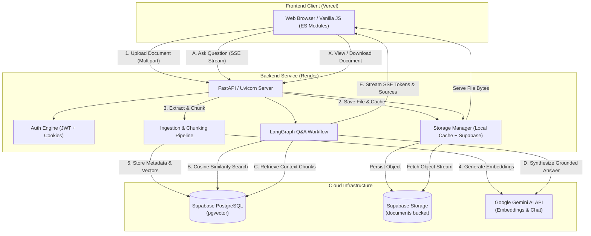

# DocMe — Research & Document Intelligence Platform

DocMe is an end-to-end, production-ready research intelligence platform designed for researchers, academics, and engineering teams. Users can upload research papers, academic articles, and technical documentation across multiple formats (PDF, DOCX, TXT), automatically extract and chunk text content, compute semantic embeddings using Google Gemini (`text-embedding-004`), index high-dimensional vectors in PostgreSQL using `pgvector`, and perform grounded conversational question-answering with real-time streaming citations orchestrated via LangGraph workflows.

---

## Live Website

Access the production deployment of DocMe:

[](https://docme-frontend.vercel.app/)

**Primary URL:** [https://docme-frontend.vercel.app/](https://docme-frontend.vercel.app/)

---

## Features

- **Multi-Format Document Ingestion:** Uploads, validates, and parses PDF, Microsoft Word (`.docx`), and plain text (`.txt`) documents with strict file-type and size checks.
- **SHA-256 Deduplication:** Computes cryptographic hashes of incoming files to prevent redundant uploads and avoid re-indexing existing content.
- **Semantic Chunking & Vector Indexing:** Extracts text, chunks content with configurable token overlaps, and generates 768-dimensional vector embeddings via Google Gemini (`text-embedding-004`), indexed in PostgreSQL with `pgvector` HNSW/cosine indexes.
- **Agentic Conversational Q&A:** LangGraph-orchestrated question-answering workflow that retrieves relevant context chunks, ranks sources, and generates precise, grounded answers using Google Gemini with page-level citations.
- **Real-Time Token Streaming:** Supports Server-Sent Events (SSE) streaming (`stream=true`) for live, token-by-token answer generation in the document chat interface.
- **In-Browser Document Viewer & Downloader:** Dedicated document previewer and authenticated download endpoints supporting inline browser viewing and attachment downloads.
- **Persistent Cloud Storage:** Cloud object storage powered by Supabase Storage (`documents` private bucket) with local container caching, ensuring document files persist across server deployments and restarts.
- **Streamlined Authentication:** Direct email and username registration and login with bcrypt-hashed passwords, stateless JWT access tokens, and secure HTTP-only refresh cookies with session rotation.
- **Social Research Feed & Collaboration:** Public research feed, search query filtering, document popularity metrics, user contributor leaderboards, and per-document comment discussions.
- **Strict Access Control:** Enforces private vs. public visibility on retrieval, chat, download, and metadata management, ensuring private documents are accessible only to their owners.

---

## Tech Stack

| Layer | Technology | Description |
| :--- | :--- | :--- |
| **Frontend** | Vanilla JavaScript (ES Modules), HTML5, CSS3 | Zero-dependency, performant client with modern responsive design and CSS design tokens |
| **Backend Framework** | Python 3.10+, FastAPI, Uvicorn | Asynchronous REST API server with OpenAPI docs and Server-Sent Events (SSE) streaming |
| **AI & Orchestration** | LangChain, LangGraph, Google Gemini API | `text-embedding-004` (768-dim embeddings) and `gemini-1.5-flash` for conversational synthesis |
| **Database & Vector Store** | PostgreSQL 15+ with `pgvector` (Supabase) | Relational schema storage combined with vector cosine similarity search |
| **Object Storage** | Supabase Storage (`documents` bucket) | Durable, persistent cloud object storage with local filesystem caching |
| **Frontend Hosting** | Vercel | Static CDN deployment with build-time environment variable injection (`scripts/build.js`) |
| **Backend Hosting** | Render | Managed container web service running FastAPI and Uvicorn |

---

## High-Level Architecture and Request Flow



### Request Flow Summaries

1. **Document Ingestion Flow:**
   - The user submits a document via `POST /documents`.
   - The backend validates file format, size, and user credentials.
   - The storage manager streams the file into the persistent Supabase Storage `documents` bucket and caches a local copy.
   - The ingestion pipeline extracts text, generates semantically coherent chunks, computes 768-dimensional embeddings via Google Gemini (`text-embedding-004`), and stores document records and chunk vectors into PostgreSQL.
2. **Conversational Q&A Flow:**
   - The client connects via `POST /documents/{document_id}/chat?stream=true`.
   - FastAPI verifies authorization (public document or owned private document).
   - The LangGraph workflow queries `pgvector` for top matching chunks via cosine distance.
   - Context is injected into a strict grounding prompt sent to Google Gemini.
   - Real-time tokens and source citations (page numbers and chunk indexes) are streamed back over Server-Sent Events (SSE).
3. **Viewing & Download Flow:**
   - The user opens the document viewer or triggers a download via `GET /documents/{document_id}/download`.
   - The storage manager checks local container cache; if absent, it fetches the file directly from Supabase Storage, caches it, and streams the file to the browser with proper MIME headers and disposition.

---

## Repository Directory Structure

```text
.
├── backend/
│   ├── app/
│   │   ├── auth.py              # JWT tokens, password hashing, and user dependencies
│   │   ├── chat.py              # Conversational chat handler and SSE streaming logic
│   │   ├── config.py            # Environment settings and configuration parsing
│   │   ├── database.py          # SQLAlchemy engine, session maker, and sequence synchronizer
│   │   ├── ingestion.py         # Multi-format document parsing (PDF, DOCX, TXT) and chunking
│   │   ├── main.py              # FastAPI application instance, CORS, and route definitions
│   │   ├── models.py            # SQLAlchemy database models (User, Document, Chunk, Comment)
│   │   ├── nodes.py             # LangGraph state nodes for context retrieval and synthesis
│   │   ├── retrieval.py         # Semantic vector retrieval over pgvector
│   │   ├── schema.py            # Pydantic v2 validation models and schemas
│   │   ├── semantic_search.py   # Vector similarity functions and embedding generators
│   │   ├── storage.py           # Persistent storage manager (Supabase Storage + local cache)
│   │   └── workflow.py          # Compiled LangGraph Q&A state graph
│   └── uploads/                 # Local directory for cached document files
├── frontend/
│   ├── index.html               # Landing page and platform introduction
│   ├── pages/
│   │   ├── document-chat.html   # Split-screen document viewer and conversational Q&A interface
│   │   ├── feed.html            # Research document feed, search, and rankings
│   │   ├── login.html           # Authentication and login interface
│   │   ├── profile.html         # User profile, uploaded documents manager, and stats
│   │   └── register.html        # Direct account registration interface
│   ├── shared/
│   │   ├── api.js               # Centralized API fetch wrapper and token refresher
│   │   ├── auth.js              # Client authentication state management
│   │   ├── env.js               # Runtime configuration populated during build
│   │   └── styles.css           # Global CSS variables, reset, layout, and component styling
│   └── vercel.json              # Vercel deployment routing and cache header configuration
├── scripts/
│   ├── build.js                 # Deployment script injecting backend API URL into frontend
│   └── migrate_to_supabase_storage.py # Migration tool to transfer local files to Supabase Storage
├── tests/
│   ├── test_backend.py          # Pytest suite for API endpoints and document workflows
│   ├── test_chat_diagnostics.py # Tests for chat retrieval and LangGraph execution
│   ├── test_session_isolation.py# Tests for multi-user session boundaries and private doc security
│   ├── test_simplified_auth.py  # Tests for direct registration, login, and sequence sync
│   ├── test_backend_url_config.mjs # Frontend test verifying build URL injection
│   ├── test_document_deletion_frontend.mjs # Frontend test for document deletion workflows
│   ├── test_frontend_auth.mjs   # Frontend test for token persistence and session expiry
│   ├── test_frontend_otp.mjs    # Frontend test verifying absence of obsolete OTP forms
│   ├── test_profile_upload.mjs  # Frontend test for upload modal interactions
│   └── test_responsiveness.mjs  # Frontend responsive layout validation
├── .env.example                 # Comprehensive environment variable template
├── package.json                 # Node.js project manifest and frontend test scripts
├── requirements.txt             # Python dependencies manifest
├── vercel.json                  # Root Vercel configuration
└── README.md                    # Project documentation
```

---

## Prerequisites

Before setting up DocMe, ensure your system has the following installed:

- **Python:** Version `3.10` or higher
- **Node.js:** Version `18.0.0` or higher with `npm`
- **PostgreSQL Database:** PostgreSQL `15+` with the `pgvector` extension installed, or an active [Supabase](https://supabase.com/) project
- **Supabase Storage:** A bucket named `documents` configured with private access
- **Google AI Studio Key:** A valid Gemini API key with access to `text-embedding-004` and `gemini-1.5-flash`

---

## Environment Variables and Configuration

DocMe separates backend service configuration from frontend client settings. Production environment variables are configured directly within the **Render Dashboard** (backend) and **Vercel Dashboard** (frontend).

> [!IMPORTANT]
> The `.env` file contains sensitive credentials and must **never** be committed to Git. Ensure `.env` is listed in your `.gitignore` file.

### Backend Environment Variables (`.env` or Render Dashboard)

| Variable | Required | Default | Description |
| :--- | :---: | :---: | :--- |
| `DATABASE_URL` | **Yes** | — | SQLAlchemy PostgreSQL connection URI (e.g., `postgresql+psycopg://postgres:<PASSWORD>@db.<PROJECT-REF>.supabase.co:5432/postgres?sslmode=require`) |
| `JWT_SECRET_KEY` | **Yes** | — | Cryptographically random key used to sign JWT access and refresh tokens |
| `JWT_ALGORITHM` | No | `HS256` | JWT signing algorithm |
| `ACCESS_TOKEN_EXPIRE_MINUTES` | No | `60` | Lifespan of short-lived JWT access tokens |
| `REFRESH_TOKEN_EXPIRE_DAYS` | No | `7` | Lifespan of the refresh token cookie |
| `COOKIE_SECURE` | **Yes** | `false` | Set to `true` in production (requires HTTPS); `false` for non-HTTPS development |
| `COOKIE_SAMESITE` | **Yes** | `lax` | Set to `none` when frontend and backend are hosted on different domains over HTTPS |
| `GEMINI_API_KEY` | **Yes** | — | Google Gemini API key for embeddings and Q&A |
| `GEMINI_EMBEDDING_MODEL` | No | `models/text-embedding-004` | Gemini model for generating vector embeddings |
| `EMBEDDING_DIMENSION` | No | `768` | Vector dimensions produced by the embedding model |
| `GEMINI_CHAT_MODEL` | No | `models/gemini-1.5-flash` | Gemini model for conversational document synthesis |
| `SUPABASE_URL` | **Yes** | — | Supabase project API URL (e.g., `https://<PROJECT-REF>.supabase.co`) |
| `SUPABASE_SERVICE_ROLE_KEY` | **Yes** | — | Supabase `service_role` key used by the backend to write to the private storage bucket |
| `SUPABASE_STORAGE_BUCKET` | No | `documents` | Name of the Supabase Storage bucket for document storage |
| `STORAGE_BACKEND` | No | `auto` | Set to `supabase` (or `auto`) to use persistent cloud storage |
| `MAX_UPLOAD_SIZE_MB` | No | `20` | Maximum allowable file upload size in megabytes |
| `UPLOAD_DIR` | No | `backend/uploads` | Path to the local filesystem cache for document files |
| `CORS_ORIGINS` | **Yes** | — | Comma-separated list of allowed frontend origins (e.g., `https://docme-frontend.vercel.app`) |
| `PORT` | No | `8000` | Port for the Uvicorn ASGI server |

### Frontend Environment Variables (Vercel Dashboard)

| Variable | Required | Description |
| :--- | :---: | :--- |
| `DOCME_API_URL` | **Yes** (Prod) | Public URL of the deployed FastAPI backend (e.g., `https://<render-service-name>.onrender.com`) |

### Client-Side Build-Time Configuration Injection

Vercel environment variables are **not** automatically exposed to vanilla browser-side JavaScript. DocMe solves this cleanly using a zero-dependency build script:

1. When Vercel runs `npm run build` (configured in `vercel.json`), it executes `node scripts/build.js --prod`.
2. The script validates that `DOCME_API_URL` is a valid `https://` endpoint (failing fast if missing or pointing to a development host).
3. It writes the resolved URL into `frontend/shared/env.js` and updates the `<meta name="docme-api-url">` tags across all HTML pages.
4. Client scripts import `ENV_CONFIG` from `shared/env.js` at runtime, ensuring reliable communication with the Render backend.

> [!WARNING]
> Never configure backend secrets (such as database credentials, Gemini API keys, or Supabase service keys) in Vercel environment variables. Only the public backend URL (`DOCME_API_URL`) should be provided to the frontend.

---

## Database Setup

DocMe utilizes PostgreSQL with the `pgvector` extension for storing relational metadata and performing vector similarity searches.

### 1. Provision Database on Supabase

1. Create a project at [supabase.com](https://supabase.com/).
2. Navigate to **Database Settings** and obtain your PostgreSQL connection string. Use the connection string with the `postgresql+psycopg://` driver prefix.
3. In the Supabase SQL Editor, verify that the `vector` extension is enabled:
   ```sql
   CREATE EXTENSION IF NOT EXISTS vector;
   ```

### 2. Configure Storage Bucket

1. In your Supabase dashboard, navigate to **Storage**.
2. Create a new bucket named `documents`.
3. Set the bucket to **Private** (authenticated downloads and streaming are managed securely through backend access checks).

### 3. Initialize Schema & Synchronize Sequences

DocMe includes an automated database initialization and sequence synchronization routine. Run the following command from the repository root:

```bash
python -m backend.app.database
```

This command will:
- Enable the `vector` extension if not already present.
- Create all required tables (`users`, `documents`, `document_chunks`, `comments`).
- Ensure all necessary columns exist.
- Synchronize PostgreSQL primary key sequences with existing data to prevent unique constraint conflicts.

---

## Backend Development Setup

Follow these steps to run the FastAPI backend locally:

### 1. Create a Virtual Environment

```bash
python3 -m venv venv
source venv/bin/activate
```

*(On Windows PowerShell: `.\venv\Scripts\Activate.ps1`)*

### 2. Install Dependencies

```bash
pip install -r requirements.txt
```

### 3. Configure Local Environment

Copy the example environment configuration:

```bash
cp .env.example .env
```

Open `.env` and fill in your database connection string, Gemini API key, Supabase storage credentials, and a randomly generated `JWT_SECRET_KEY` (generate one with `openssl rand -hex 32`).

### 4. Initialize Database

```bash
python -m backend.app.database
```

### 5. Start the Backend Server

```bash
uvicorn backend.app.main:app --reload --host 0.0.0.0 --port 8000
```

The API will be available at port `8000`. You can inspect the interactive OpenAPI documentation at `/docs`.

---

## Frontend Setup

The frontend consists of vanilla JavaScript (ES modules), HTML5, and CSS3, requiring no bundling tool or heavy JavaScript framework.

### 1. Install Node.js Test Dependencies

```bash
npm install
```

### 2. Reset or Build Configuration

To configure the frontend for local development, run:

```bash
npm run build:clean
```

This clears production build injections in `frontend/shared/env.js`, enabling the client to fall back to the local API server automatically.

To test a production build locally with a custom backend URL:

```bash
DOCME_API_URL="https://your-backend-service.onrender.com" npm run build
```

### 3. Serve Frontend Files

Serve the `frontend/` directory using any static file server:

```bash
# Using Python
python3 -m http.server 3000 --directory frontend

# Or using Node npx serve
npx serve frontend -p 3000
```

Open your browser to port `3000` to interact with DocMe.

---

## API Overview

The FastAPI backend exposes a comprehensive RESTful API with automated OpenAPI documentation at `/docs`.

### Status & System

| Method | Endpoint | Auth Required | Description |
| :--- | :--- | :---: | :--- |
| `GET` | `/` | No | Service health check and storage backend status |

### Authentication

| Method | Endpoint | Auth Required | Description |
| :--- | :--- | :---: | :--- |
| `POST` | `/register` | No | Direct user registration (`username`, `email`, `password`); returns user profile |
| `POST` | `/login` | No | Authenticate user; returns JWT access token and sets HTTP-only refresh cookie |
| `POST` | `/refresh` | Cookie | Exchanges valid refresh token cookie for a new JWT access token |
| `POST` | `/logout` | Optional | Clears the refresh token cookie and invalidates user session |
| `GET` | `/me` | Yes | Retrieves profile data for the currently authenticated user |

> [!NOTE]
> Authentication is direct and streamlined. Email OTP verification has been removed from the registration flow; new users can register and log in immediately. Obsolete OTP endpoints return `404 Not Found`.

### Documents & Ingestion

| Method | Endpoint | Auth Required | Description |
| :--- | :--- | :---: | :--- |
| `POST` | `/documents` | Yes | Upload and process a new document (`multipart/form-data`: `file`, `title`, `visibility`) |
| `GET` | `/documents` | Yes | Retrieve all documents owned by the authenticated user |
| `GET` | `/documents/{document_id}` | Public/Owner | Retrieve detailed metadata for a specific document |
| `PATCH` | `/documents/{document_id}` | Owner | Update title, description, or visibility (`public`/`private`) of a document |
| `DELETE` | `/documents/{document_id}` | Owner | Deletes document, chunks, embeddings, comments, and storage object |
| `GET` | `/documents/{document_id}/download` | Public/Owner | Download original file; supports `?inline=true` for browser rendering |

### Research Feed & Discovery

| Method | Endpoint | Auth Required | Description |
| :--- | :--- | :---: | :--- |
| `GET` | `/feed` | No | Retrieve public research document feed |
| `GET` | `/documents/search?query=...` | No | Perform keyword search across public documents |
| `GET` | `/documents/popular` | No | Retrieve list of popular documents ranked by activity |
| `GET` | `/users/ranking` | No | Retrieve contributor leaderboard ranked by document contributions |
| `GET` | `/users/{user_id}` | No | Retrieve public profile for a specific user |
| `GET` | `/users/{user_id}/documents` | No | Retrieve public documents published by a specific user |

### Document Comments

| Method | Endpoint | Auth Required | Description |
| :--- | :--- | :---: | :--- |
| `POST` | `/documents/{document_id}/comments` | Yes | Add a new comment to a document |
| `GET` | `/documents/{document_id}/comments` | Public/Owner | Retrieve all comments for a document |

### Conversational Q&A (LangGraph)

| Method | Endpoint | Auth Required | Description |
| :--- | :--- | :---: | :--- |
| `POST` | `/documents/{document_id}/chat` | Yes | Ask questions grounded in document context; supports `?stream=true` for Server-Sent Events (SSE) streaming |

---

## Testing

DocMe features automated test suites for both backend and frontend components.

### 1. Run Backend Test Suite

The backend test suite uses `pytest` and runs against an isolated PostgreSQL test database:

```bash
pytest tests/
```

Key test modules include:
- `tests/test_backend.py`: General route integration, document CRUD, and comment endpoints.
- `tests/test_simplified_auth.py`: Direct registration, login, cookie refresh, sequence synchronizer, and verification that obsolete OTP endpoints return 404.
- `tests/test_session_isolation.py`: Cross-user session boundaries and private document protection.
- `tests/test_chat_diagnostics.py`: LangGraph context retrieval, prompt construction, and Gemini synthesis.

### 2. Run Frontend Test Suite

The frontend test suite runs native Node.js assertion tests to validate client-side logic:

```bash
npm run test:frontend
```

This command runs tests verifying:
- Client authentication state and token refresh mechanics (`test_frontend_auth.mjs`)
- Build-time API URL injection into ES modules and HTML meta tags (`test_backend_url_config.mjs`)
- Document deletion confirmation and API calls (`test_document_deletion_frontend.mjs`)
- Typing indicator and chat message rendering (`test_typing_indicator.mjs`)
- Profile document upload flow (`test_profile_upload.mjs`)
- Absence of legacy OTP input fields in registration forms (`test_frontend_otp.mjs`)
- Viewport responsiveness and layout integrity (`test_responsiveness.mjs`)

---

## Production Deployment Overview

DocMe is engineered for high-availability cloud deployment with Render (backend) and Vercel (frontend).

### 1. Database & Storage Deployment (Supabase)

1. Provision a PostgreSQL instance on Supabase and enable `pgvector`.
2. Create a private storage bucket named `documents`.
3. In the Supabase Dashboard under **Project Settings -> API**, obtain the `Project URL` and the `service_role` key (required for backend file management).

### 2. Backend Deployment (Render)

1. Connect your Git repository to [Render](https://render.com/) and create a new **Web Service**.
2. Configure service settings:
   - **Environment:** Python
   - **Build Command:** `pip install -r requirements.txt`
   - **Start Command:** `uvicorn backend.app.main:app --host 0.0.0.0 --port $PORT`
3. Configure Environment Variables in the Render Dashboard:
   - `DATABASE_URL`: Your Supabase connection string (`postgresql+psycopg://...`)
   - `JWT_SECRET_KEY`: Secure 64-character hex string
   - `COOKIE_SECURE`: `true`
   - `COOKIE_SAMESITE`: `none`
   - `GEMINI_API_KEY`: Your Google AI Studio API key
   - `SUPABASE_URL`: `https://<PROJECT-REF>.supabase.co`
   - `SUPABASE_SERVICE_ROLE_KEY`: Your Supabase service role secret
   - `SUPABASE_STORAGE_BUCKET`: `documents`
   - `STORAGE_BACKEND`: `supabase`
   - `CORS_ORIGINS`: `https://docme-frontend.vercel.app`
4. Deploy the service and record your public Render URL (e.g., `https://<render-service-name>.onrender.com`).

### 3. Frontend Deployment (Vercel)

1. Import your Git repository into [Vercel](https://vercel.com/).
2. Configure project build settings:
   - **Framework Preset:** Other
   - **Root Directory:** `./`
   - **Build Command:** `npm run build:prod`
   - **Output Directory:** `frontend`
3. Configure Environment Variables in the Vercel Dashboard:
   - `DOCME_API_URL`: `https://<render-service-name>.onrender.com` (your Render backend URL)
4. Deploy the project. The build command will inject the API URL into `frontend/shared/env.js` and HTML meta tags.

---

## Security Notes

- **Stateless Tokens & Secure Cookies:** Access tokens are short-lived JWTs held in client memory. Refresh tokens are stored in `HttpOnly`, `Secure`, `SameSite=None` cookies, preventing cross-site scripting (XSS) token theft and cross-site request forgery (CSRF).
- **Private Object Storage:** Files stored in Supabase Storage reside in a private bucket. Direct public access is disabled; downloads and previews are authenticated and proxied through backend access control checks.
- **Strict Authorization:** Private documents cannot be viewed, downloaded, searched, or queried via the chat interface by any user other than the document owner.
- **Input Validation:** File uploads are validated by MIME type, file extension, and maximum file size before processing. Structured inputs are sanitized and validated using Pydantic v2 schemas.
- **Secret Protection:** Source code and client bundles contain zero credentials. Environment variables must remain untracked in Git.

---

## Troubleshooting

### 1. Document Files Missing or Failing to Download
- **Cause:** Render web services run on ephemeral container filesystems. Files uploaded prior to configuring Supabase Storage were stored only on local disk and disappear when Render restarts or redeploys containers.
- **Resolution:**
  1. Ensure `SUPABASE_URL` and `SUPABASE_SERVICE_ROLE_KEY` are configured in your Render service environment variables.
  2. If you have legacy files in your local `backend/uploads/` directory, migrate them to Supabase Storage by running:
     ```bash
     python scripts/migrate_to_supabase_storage.py
     ```
  3. Any historical documents whose files were uploaded to an ephemeral container prior to storage configuration must be re-uploaded.

### 2. Database Connection Errors with Supabase
- **Cause:** Supabase free-tier connection limits or connection pooler incompatibility.
- **Resolution:**
  - When connecting to Supabase from Render, use the Transaction Pooler connection string (`aws-0-<REGION>.pooler.supabase.com:6543`) with `sslmode=require` and the `postgresql+psycopg://` driver prefix.
  - Verify that `DB_POOL_SIZE` is set conservatively (e.g., `5` with `DB_MAX_OVERFLOW=5`) to prevent exhausting pool connections.

### 3. CORS and Cross-Origin Cookie Errors
- **Cause:** Mismatch between the frontend origin and the backend CORS configuration, or invalid cookie flags.
- **Resolution:**
  - Verify that `CORS_ORIGINS` in your backend environment variables includes the exact Vercel frontend URL (`https://docme-frontend.vercel.app`) without a trailing slash.
  - When frontend and backend reside on different domains, ensure `COOKIE_SECURE=true` and `COOKIE_SAMESITE=none` are set in the backend environment variables.

### 4. Vercel Frontend Fails to Connect to Backend
- **Cause:** Missing or misconfigured `DOCME_API_URL` during the Vercel build step.
- **Resolution:**
  - Check the Vercel build logs. The build script `scripts/build.js` validates `DOCME_API_URL` and will fail if the variable is missing or points to a development host.
  - Add `DOCME_API_URL` under **Project Settings -> Environment Variables** in Vercel and redeploy.

---

## Contributing and License

### Contributing

Contributions to DocMe are welcome! Please adhere to the following workflow:

1. Fork the repository and create a feature branch (`git checkout -b feature/my-feature`).
2. Make your modifications following repository conventions.
3. Verify that all tests pass:
   ```bash
   pytest tests/
   npm run test:frontend
   ```
4. Commit your changes and submit a pull request with a clear description of your improvements.

### License

This project is licensed under the terms of the [MIT License](LICENSE).
